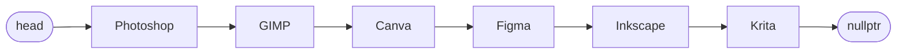

# Практична робота: Однозв’язний список `std::forward_list` у C++

**Варіант:** 14
**Тематика списку:** Графічні редактори

## Мета роботи

Опанувати роботу з однозв’язним списком `std::forward_list` у C++: навчитися створювати список, додавати й видаляти елементи, шукати елементи за допомогою ітератора, обробляти елементи списку та вставляти новий елемент після знайденого за допомогою `insert_after()`.

## Вхідні дані (варіант 14)

| Параметр | Значення |
|---|---|
| Тематика | Графічні редактори |
| Початкові елементи | Photoshop, GIMP, Canva, Figma, Krita |
| Елемент для пошуку | Figma |
| Елемент для вставки | Inkscape |

## Виконані завдання

1. **Ініціалізація та виведення елементів** — створено `forward_list<string>` і виведено всі елементи за допомогою ітератора.
2. **Додавання та видалення елементів** — створено список з першого елемента (`Photoshop`), додано на початок два елементи (`Illustrator`, `CorelDRAW`) методом `push_front()`, виведено список, видалено перший елемент методом `pop_front()` і виведено список повторно.
3. **Знаходження та перевірка наявності елемента** — за допомогою ітератора перевірено наявність `Figma` та виведено «Елемент знайдено» або «Елемент не знайдено».
4. **Підрахунок кількості символів** — обчислено загальну кількість символів у назвах усіх елементів списку.
5. **Вставка елемента у список** — знайдено `Figma` та після нього методом `insert_after()` вставлено `Inkscape`; виведено оновлений список.

## Програмний код

```cpp
#include <iostream>
#include <forward_list>
#include <string>
using namespace std;

int main()
{
    // Завдання 1. Ініціалізація та виведення елементів
    forward_list<string> editors = {"Photoshop", "GIMP", "Canva", "Figma", "Krita"};
    cout << "Завдання 1. Графічні редактори:" << endl;
    for (auto it = editors.begin(); it != editors.end(); ++it)
    {
        cout << *it << " ";
    }

    // Завдання 2. Додавання та видалення елементів
    forward_list<string> list2 = {"Photoshop"};
    list2.push_front("Illustrator");
    list2.push_front("CorelDRAW");
    cout << "\n\nЗавдання 2. Після додавання:" << endl;
    for (string e : list2)
    {
        cout << e << " ";
    }
    list2.pop_front();
    cout << "\nПісля видалення першого елемента:" << endl;
    for (string e : list2)
    {
        cout << e << " ";
    }

    // Завдання 3. Пошук елемента
    string searchElement = "Figma";
    bool found = false;
    auto it = editors.begin();
    while (it != editors.end())
    {
        if (*it == searchElement)
        {
            found = true;
            break;
        }
        ++it;
    }
    cout << "\n\nЗавдання 3. ";
    if (found)
        cout << "Елемент знайдено";
    else
        cout << "Елемент не знайдено";

    // Завдання 4. Підрахунок кількості символів
    int sum = 0;
    for (auto i = editors.begin(); i != editors.end(); ++i)
    {
        sum = sum + i->length();
    }
    cout << "\n\nЗавдання 4. Загальна кількість символів: " << sum;

    // Завдання 5. Вставка елемента після знайденого
    string newElement = "Inkscape";
    it = editors.begin();
    bool inserted = false;
    while (it != editors.end())
    {
        if (*it == searchElement)
        {
            editors.insert_after(it, newElement);
            inserted = true;
            break;
        }
        ++it;
    }
    cout << "\n\nЗавдання 5. ";
    if (!inserted)
    {
        cout << "Елемент для пошуку відсутній у списку";
    }
    else
    {
        cout << "Оновлений список:" << endl;
        for (auto i = editors.begin(); i != editors.end(); ++i)
        {
            cout << *i << " ";
        }
    }

    return 0;
}
```

## Результат виконання

```
Завдання 1. Графічні редактори:
Photoshop GIMP Canva Figma Krita

Завдання 2. Після додавання:
CorelDRAW Illustrator Photoshop
Після видалення першого елемента:
Illustrator Photoshop

Завдання 3. Елемент знайдено

Завдання 4. Загальна кількість символів: 28

Завдання 5. Оновлений список:
Photoshop GIMP Canva Figma Inkscape Krita
```

## Скріншоти роботи програми

> Встав сюди скріншот коду та терміналу з онлайн-компілятора.


## Візуалізація структури однозв’язного списку

**Початковий список:**

```
head → [Photoshop] → [GIMP] → [Canva] → [Figma] → [Krita] → nullptr
```

**Після вставки `Inkscape` за допомогою `insert_after()`:**

```
head → [Photoshop] → [GIMP] → [Canva] → [Figma] → [Inkscape] → [Krita] → nullptr
```

Те саме у вигляді діаграми:



## Висновок

У ході практичної роботи я ознайомився з контейнером `std::forward_list`, який реалізує однозв’язний список: кожен вузол зберігає значення та вказівник лише на наступний елемент, тому рух можливий тільки вперед. Було використано методи `push_front()` та `pop_front()` для додавання й видалення елементів на початку списку, ітератори (`begin()`, `end()`) для перебору та пошуку елементів, а також цикл `for-each`. Метод `insert_after()` дозволив вставити новий елемент одразу після знайденого, оскільки в однозв’язному списку вставка виконується після позиції ітератора (на відміну від `std::list`, де `insert()` вставляє елемент перед ітератором). Усі п’ять завдань варіанта 14 виконано, результати збігаються з очікуваними.
